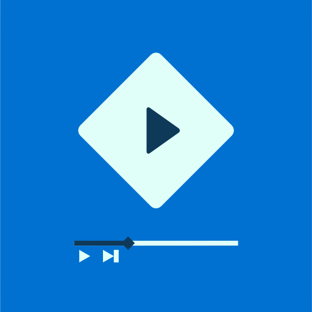

# Stremio PS4

An unofficial, native [Stremio](https://www.stremio.com) client for
jailbroken PlayStation 4 consoles. It's designed for the TV and the
DualShock 4, and plays the streams from your Stremio add-ons on the console
itself.

## Features

- **Sign in with a QR code:** scan it with a phone that's logged in to
  Stremio. No typing on the TV.
- **Home:**
  - Continue watching, with progress and new-episode badges.
  - Rows from your add-on catalogues.
- **Search** across all your add-ons, with an on-screen keyboard.
- **Library:** everything in your Stremio library as a poster grid, filtered
  by type and sorted by recently watched, name or most watched. Add or
  remove titles from their details page with △.
- **Details:** description, seasons and episodes, and every stream your
  add-ons offer, with a filter to show one add-on's streams at a time.
  Torrent streams from Torrentio show their size and seeders, coloured by
  how quickly they are likely to start (green 15+, amber 5–14, red under 5).
- **Torrent streams play on the console itself,** with no streaming server
  or PC. A built-in engine downloads the pieces in playback order into
  memory, and shows its progress (peers, speed) while loading.
- **Player:**
  - Plays MKV and MP4, H.264, HEVC (including 10-bit), AAC, AC3/E-AC3, DTS
    and more. Decoding is done in software with FFmpeg, and it handles
    1080p.
  - Subtitles embedded in the video (text and Blu-ray/DVD image subtitles)
    or from subtitle add-ons such as OpenSubtitles, grouped into one tab
    per language.
  - Audio track selection.
  - Remembers your subtitle and audio languages.
- **Synced with your account:** watch progress is saved to your Stremio
  library, so you can continue on any device.

## Requirements

- A PS4 or PS4 Pro running [GoldHEN](https://github.com/GoldHEN/GoldHEN).
  Tested on a PS4 Slim with FW 11.02.
- A Stremio account with add-ons that provide **torrent streams** (e.g.
  Torrentio) or **direct (HTTP/HTTPS) streams** (e.g. a debrid service).

## Installing

1. Download `stremio-ps4-<version>.pkg` from the
   [releases](../../releases), or [build it yourself](BUILDING.md).
2. Copy it to the console, for example with GoldHEN's FTP server, into
   `/data/pkg/`.
3. Install it with GoldHEN's Package Installer.
4. Open **Stremio PS4** and scan the QR code.

## Controls

| Button | Action |
|---|---|
| D-pad | Move |
| × | Select / play-pause |
| ○ | Back |
| L1 / R1 | Previous / next tab (Home, Search, Library, Settings); on a details page, the add-on filter; in Audio & subtitles, the subtitle language |
| ◀ ▶ (in the player) | Seek 10 s (presses add up) |
| ▲ (in the player) | Audio & subtitles |

## Limitations

- **Torrents are download-only:** the app never uploads or seeds. Pieces
  are kept in memory (about 200 MB at most), not on disk, so going back
  more than a few seconds, or to a part watched long ago, downloads it
  again. Torrents with few reachable peers can take 10–20 s to start.
- **Seeders and size only show for Torrentio.** The app reads them from the
  stats line Torrentio adds to each stream; streams from other add-ons show
  their own text, without the badge.
- **YouTube and external links** aren't supported. Streams that can't be
  played are listed but greyed out.
- **Non-Latin subtitles** (Arabic, Hebrew, Persian, Chinese, Japanese,
  Korean, Hindi and other Indic scripts, Thai...) are drawn with bundled Noto
  fonts and shaped with HarfBuzz. Files in legacy encodings are converted
  using the subtitle's language. Styling (ASS colours, positions) isn't kept.

What's planned next is in [docs/ROADMAP.md](docs/ROADMAP.md).

## Building

See [BUILDING.md](BUILDING.md). `./build.sh ps4` builds the package
reproducibly in Docker. The technical background is in
[docs/ARCHITECTURE.md](docs/ARCHITECTURE.md).

## Contributing

Bug reports and pull requests are welcome; see
[CONTRIBUTING.md](CONTRIBUTING.md).

## License

Stremio PS4 is free software, licensed under the
[GNU General Public License v3.0](LICENSE). It bundles FFmpeg (LGPL 2.1),
HarfBuzz (MIT), the Inter and Noto fonts (SIL Open Font License) and stb
(public domain), and parts of
its logic are ported from stremio-core (MIT, © 2019 SmartCode OOD); see
[BUILDING.md](BUILDING.md#licences-of-bundled-components).

## Disclaimer

This project is not affiliated with, endorsed or sponsored by Stremio (Smart
Code OOD) or Sony Interactive Entertainment. "Stremio" is a trademark of
Smart Code OOD; "PlayStation", "PS4" and the PlayStation button symbols are
trademarks of Sony Interactive Entertainment Inc. They are used only to
describe what this app works with.

Stremio PS4 is homebrew for jailbroken consoles. Running it is at your own
risk. It uses Stremio's public API and add-on protocol, and it doesn't host
or provide any content. What you watch comes from the add-ons you install.
